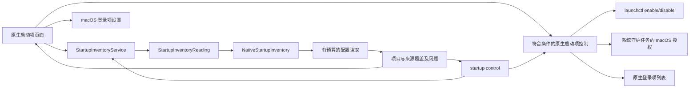

# 启动项管理

[English](../../product/startup-items.md) | 简体中文

macOS 原生页面按已确认的应用路径聚合启动项，提供总数与启用计数、全部／已启用／已禁用／残留项筛选、搜索、行内开关和展开详情。直接控制覆盖符合条件的 LaunchAgent、第三方系统守护任务和原生应用登录项；其余注册保留 macOS 设置入口。Windows 来源、控制范围与验证边界见下文。

## 用户流程

打开“启动项”读取 launchd 定义和可用的登录注册。可按应用、发布者、标签、配置路径或执行路径搜索。展开应用后查看每项注册的来源、配置状态、运行状态和触发线索，复制路径或在访达定位。Apple 系统定义通过“启动项选项”主动纳入。“重新扫描”读取新事实，“停止”请求协作取消；刷新时保留已有列表。

启用、禁用和移除均先展示确切受影响配置并要求确认。启停更改当前用户 GUI 域的 launchd 覆盖设置；移除仅把符合条件的当前用户普通配置通过既有文件系统适配移到废纸篓。不会终止已运行进程。平台重新核验来源、父目录、所有者、文件身份、内容及标签，并回读覆盖设置或验证废纸篓结果。整组操作存在部分失败时也重新扫描。

`/Library/LaunchDaemons` 直属、由 root 拥有且符合安全条件的第三方配置，通过固定的 `launchctl enable/disable system/<label>` 操作请求 macOS 管理员授权；Apple 配置继续受保护。原生登录项只增删当前账户登录列表中确切的本地第三方应用，执行前核验完整快照与身份，执行后重新读取验证。BTM 应用记录优先采用原生列表判断启用状态；仅有 BTM 回退事实时保留只读。

仅在本地文件系统能确认执行目标不存在时标为残留。无权限、无法解析的执行路径、链接和离线卷保留未知状态。同名不代表同一应用；部分启用单独呈现，未知状态不会当作禁用。系统设置入口使用公开的 `SMAppService.openSystemSettingsLoginItems()` API。

## 覆盖与隐私

| 来源 | 默认行为 | 事实范围 |
| --- | --- | --- |
| `~/Library/LaunchAgents` | 包含 | 当前用户配置 |
| `/Library/LaunchAgents` | 包含 | 所有用户代理配置 |
| `/Library/LaunchDaemons` | 包含 | 所有用户守护配置 |
| `/System/Library/LaunchAgents`、`/System/Library/LaunchDaemons` | 可选 | Apple 系统配置 |
| 活跃登录项 | 原生共享列表可用时包含 | 完整原生快照；符合条件的确切应用支持启停 |
| 后台应用记录 | BTM v13 可读时包含 | 有界、纯数据 plist 解析；版本及权限缺口明确列出 |
| 应用内辅助程序 | 本次扫描范围之外 | 在系统设置中查看 |

`complete` 仅表示本次请求的配置来源已检查，不代表已枚举 macOS 全部启动注册项目。来源不存在、权限缺口、无效配置和预算限制分别记录；读取失败不能解释为没有启动项。

读取使用目录描述符，拒绝祖先与末级链接、拒绝特殊文件，并在读取后比较文件元数据。单份配置上限为 256 KiB，默认最多遍历 2,000 项、五秒，在操作之间检查取消与单调时钟截止时间；无法中断内核中不可中断的文件系统调用。不保留或输出参数与环境变量值；可执行文件仅取绝对且可显示的 Program 字段或 ProgramArguments 首项。状态查询仅返回固定状态；成功查询且无覆盖时采用 Disabled 配置默认值，查询失败则保留未知。BTM 读取拒绝未知版本，不实例化归档类。发现阶段不会执行改变状态的命令。

## 职责与流程



Core 负责可移植结果、纯应用聚合／筛选和启停合同；平台适配负责来源路径、定义解析、物理读取、原生注册和授权边界；桌面负责搜索、原生呈现、确认和系统设置导航。发现与启停过程不打开清理记录存储，不能产生清理计划。

## Windows 启动项

Windows 复用同一份 Core 模型与服务。默认读取当前用户 Run、RunOnce、启动文件夹，以及任务计划程序中确切属于当前账户的登录／开机任务。“包含全机”另外读取 32／64 位全机 Run／RunOnce、公共启动文件夹、其他账户的登录／开机任务及自动启动／已停用系统服务。每个来源分别报告完成、缺失、部分、无法读取或预算内未扫描；打包应用 StartupTask、组策略脚本和 Winlogon 扩展明确列为未覆盖。

注册表命令只取无歧义的绝对可执行路径，不输出参数或环境变量值，不搜索 PATH。启动文件夹不跟随文件系统重解析点；`.lnk` 通过有界字节读取和原生 Shell Link 流解析提取内嵌路径，不调用 Resolve、不搜索移动目标、不访问网络目标或显示系统对话框。无法确认的目标保留未知，不标为残留。注册表和启动文件夹的有效启用状态可能另受系统启动设置或策略影响，因此保留未知，Shou 不改写未公开的 StartupApproved 数据。任务和服务分别报告配置与运行状态。

WPF 提供来源清单、搜索、全部／启用／停用／目标缺失筛选、配置与运行状态、覆盖详情，以及 Windows 启动设置、任务计划程序和服务管理入口。同名注册项保持独立；没有应用归属证据时不猜测应用分组。

直接启停仅覆盖当前账户、非 `\\Microsoft\\` 系统树、带登录或开机触发器且定义可完整读取的计划任务。预览绑定路径、配置、执行目标和原生证据摘要，单次确认再绑定操作；平台重新核对当前账户与完整 XML，调用公开任务接口修改 Enabled 后重新获取任务，验证仅该配置改变。操作不会立即启动任务，也不会停止已运行实例。写入开始后无法核实时报告可能已变更，必须重新扫描，不自动重试；其他来源仅提供系统管理入口。没有新增整体提权、注册表删除、任务删除或服务变更。

CLI `startup list` 在 Windows 返回 `scope: windows_startup_items`；`startup control --path '\\Folder\\Task' --action disable` 使用列表中的确切任务路径并要求当前终端确认。桌面桥使用 `startup.scan` 和 `startup.control`；读取独立于清理存储。默认共享读取预算为 2,000 项／五秒，检查发生在原生操作之间，不能强制中断正在执行的 COM 或内核调用。

当前验证包括主机上的 4 项 Windows 合同专项、完整核心回归、WPF 构建、Windows 显式分支类型检查及 x64／ARM64 原生交叉链接。Windows CI 新增只读来源检查与拒绝／取消确认检查，验证脚本固定拒绝所有变更确认；未在当前主机执行 Windows 原生任务变更或界面旅程，不能据此宣称 Windows 启动项完整验收。

## CLI

```sh
shou startup list --json
shou startup list --include-system true --json
shou startup control --path "$HOME/Library/LaunchAgents/example.plist" --action disable
```

沿用 API `1.0` 信封，`scope` 为 `macos_startup_items`；项目新增可选 `display_name`、`application_path`、`publisher`、`target_state` 与 `removable`，旧数据解码采用安全默认值；结果包含 UTC `checked_at`、`include_system`、来源覆盖、问题及明确不可用的来源类型。覆盖存在缺口时返回 `partial` 和退出码 `6`，非法选项为 `2`，不支持的平台为 `8`。`startup list` 独立于清理存储；`startup control` 也不使用提权辅助程序、不终止进程，并受当前用户 LaunchAgents 边界限制。
`startup control` 只接受扫描结果中当前用户 `LaunchAgents` 的确切路径，`--action` 为 `enable` 或 `disable`。命令先在当前终端展示标签、路径和影响，再要求输入 `STARTUP ENABLE <label>` 或 `STARTUP DISABLE <label>`；没有 TTY、来源不受支持、所有者或 plist 在执行前发生变化时均拒绝。它不会使用 `sudo`，不会终止已运行的进程，也不会修改系统级 daemon。

## 本机验收

核心／CLI 与原生桌面证据见[验收记录](../engineering/acceptance-and-testing.md)。自动检查覆盖精确聚合与筛选、旧数据兼容、有界 BTM 解析、守护任务授权命令构造与回读、登录项身份及原生控制结果；改变状态的检查使用注入执行器和隔离夹具。桌面只读检查覆盖聚合列表、分类筛选和展开详情。实际管理员授权、已安装启动项的真实变更、系统级完整注册枚举、VoiceOver 和界面停止时机仍属于单独运行验收。
