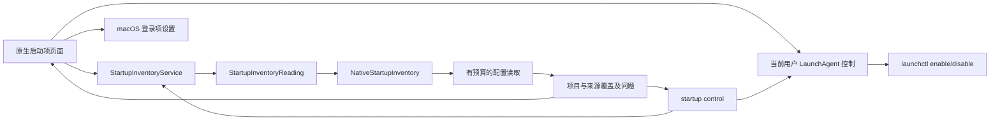

# 启动项发现

[English](../../product/startup-items.md) | 简体中文

状态：F15 首阶段已实现并完成所列本机运行验收；当前用户 LaunchAgent 的受限启停合同已实现，运行证据见[验收记录](../engineering/acceptance-and-testing.md)。系统级定义、登录项、后台注册和应用内辅助程序仍保持只读并跳转 macOS 设置。

## 用户流程

打开“启动项”，读取当前用户代理任务与本机安装的所有用户代理／守护任务。支持按标签、配置路径或可执行文件路径搜索；选择一行可检查确切来源、触发线索与可执行文件，在访达定位配置或复制路径。Apple 系统配置默认隐藏，主动选择后才纳入检查。“重新核验”读取新事实，“停止”在读取操作之间请求取消。

“打开登录项设置”使用公开的 `SMAppService.openSystemSettingsLoginItems()` API 进入 macOS 原生页面。当前用户 `~/Library/LaunchAgents` 的定义会显示“启用／停用”操作；点击后必须再次确认，Shou 会重新核验 plist、所有者、标签和确切父目录，再调用当前用户的 `launchctl enable/disable`。操作不终止已经运行的进程，完成后自动重新核验。读取当前用户代理时还会在预算内查询 `launchctl print-disabled` 和准确服务域；能观察到时返回 `enabled`、`disabled`、`loaded`、`running` 或 `not_loaded`，查询不可用或超时则返回 `unknown`。这些是读取瞬间的状态观察，不能作为修改授权；Disabled 字段仍单独作为配置线索展示。

## 覆盖与隐私

| 来源 | 默认行为 | 事实范围 |
| --- | --- | --- |
| `~/Library/LaunchAgents` | 包含 | 当前用户配置 |
| `/Library/LaunchAgents` | 包含 | 所有用户代理配置 |
| `/Library/LaunchDaemons` | 包含 | 所有用户守护配置 |
| `/System/Library/LaunchAgents`、`/System/Library/LaunchDaemons` | 可选 | Apple 系统配置 |
| 登录项、后台任务注册、应用内辅助程序 | 本次扫描范围之外 | 在系统设置中查看 |

`complete` 仅表示本次请求的配置来源已检查，不代表已枚举 macOS 全部启动注册项目。来源不存在、权限缺口、无效配置和预算限制分别记录；读取失败不能解释为没有启动项。

读取使用目录描述符，拒绝祖先与末级链接、拒绝特殊文件，并在读取后比较文件元数据。单份配置上限为 256 KiB，默认最多遍历 2,000 项、五秒，在操作之间检查取消与单调时钟截止时间；无法中断内核中不可中断的文件系统调用。不保留或输出参数与环境变量值；可执行文件仅取绝对且可显示的 Program 字段或 ProgramArguments 首项。状态查询只返回固定状态枚举且不保留命令输出，发现阶段不会执行改变状态的命令。

## 职责与流程



Core 负责可移植结果和启停合同；平台适配负责 launchd 来源路径、属性列表解析、物理读取和当前用户控制边界；桌面负责搜索、原生呈现、确认和系统设置导航。发现与启停过程不打开清理记录存储，不能产生清理计划。Windows 在独立适配完成前明确返回不支持。

## CLI

```sh
shou startup list --json
shou startup list --include-system true --json
shou startup control --path "$HOME/Library/LaunchAgents/example.plist" --action disable
```

沿用 API `1.0` 信封，`scope` 为 `launchd_definitions`；结果包含 UTC `checked_at`、`include_system`、来源覆盖、问题及明确不可用的来源类型。覆盖存在缺口时返回 `partial` 和退出码 `6`，非法选项为 `2`，不支持的平台为 `8`。`startup list` 独立于清理存储；`startup control` 也不使用提权辅助程序、不终止进程，并受当前用户 LaunchAgents 边界限制。
`startup control` 只接受扫描结果中当前用户 `LaunchAgents` 的确切路径，`--action` 为 `enable` 或 `disable`。命令先在当前终端展示标签、路径和影响，再要求输入 `STARTUP ENABLE <label>` 或 `STARTUP DISABLE <label>`；没有 TTY、来源不受支持、所有者或 plist 在执行前发生变化时均拒绝。它不会使用 `sudo`，不会终止已运行的进程，也不会修改系统级 daemon。

## 本机验收

核心／CLI 与原生桌面证据见[验收记录](../engineering/acceptance-and-testing.md)。本机默认三个来源发现 44 项，包含 Apple 来源后为 873 项；计数仅是该机器的观察值。所有读取问题继续在覆盖范围中展示。启停已覆盖核心能力合同、CLI 参数发现和受限平台实现；桌面按钮的真实 launchctl 改动、系统级完整注册枚举和 VoiceOver 仍需单独运行验收。读取快于下一次观察，桌面启动项“停止”时机尚未命中，不能用核心取消测试替代 GUI 通过。
