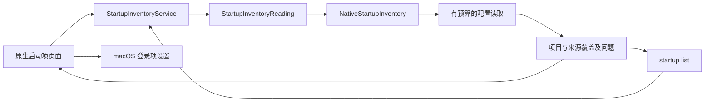

# 启动项发现

[English](../../product/startup-items.md) | 简体中文

状态：F15 首阶段已实现并完成所列本机运行验收；运行证据见[验收记录](../engineering/acceptance-and-testing.md)。本阶段发现 launchd 配置并打开 macOS 登录项设置，不改变注册状态、不停止进程、不移除文件。

## 用户流程

打开“启动项”，读取当前用户代理任务与本机安装的所有用户代理／守护任务。支持按标签、配置路径或可执行文件路径搜索；选择一行可检查确切来源、触发线索与可执行文件，在访达定位配置或复制路径。Apple 系统配置默认隐藏，主动选择后才纳入检查。“重新核验”读取新事实，“停止”在读取操作之间请求取消。

“打开登录项设置”使用公开的 `SMAppService.openSystemSettingsLoginItems()` API 进入 macOS 原生页面。配置存在不代表任务已注册、已启用或正在运行。Disabled 字段只作为配置线索展示，launchd 的覆盖设置可能不同；因此桌面与 CLI 的当前配置状态及运行状态均保持 `unknown`。

## 覆盖与隐私

| 来源 | 默认行为 | 事实范围 |
| --- | --- | --- |
| `~/Library/LaunchAgents` | 包含 | 当前用户配置 |
| `/Library/LaunchAgents` | 包含 | 所有用户代理配置 |
| `/Library/LaunchDaemons` | 包含 | 所有用户守护配置 |
| `/System/Library/LaunchAgents`、`/System/Library/LaunchDaemons` | 可选 | Apple 系统配置 |
| 登录项、后台任务注册、应用内辅助程序 | 本次扫描范围之外 | 在系统设置中查看 |

`complete` 仅表示本次请求的配置来源已检查，不代表已枚举 macOS 全部启动注册项目。来源不存在、权限缺口、无效配置和预算限制分别记录；读取失败不能解释为没有启动项。

读取使用目录描述符，拒绝祖先与末级链接、拒绝特殊文件，并在读取后比较文件元数据。单份配置上限为 256 KiB，默认最多遍历 2,000 项、五秒，在操作之间检查取消与单调时钟截止时间；无法中断内核中不可中断的文件系统调用。不保留或输出参数与环境变量值；可执行文件仅取绝对且可显示的 Program 字段或 ProgramArguments 首项，不执行其中任何命令。

## 职责与流程



Core 负责可移植结果和只读服务合同；平台适配负责 launchd 来源路径、属性列表解析及物理读取；桌面负责搜索、原生呈现与系统设置导航。发现过程不打开清理记录存储，不能产生清理计划或启动设置修改。Windows 在独立适配完成前明确返回不支持。

## CLI

```sh
shou startup list --json
shou startup list --include-system true --json
```

沿用 API `1.0` 信封，`scope` 为 `launchd_definitions`；结果包含 UTC `checked_at`、`include_system`、来源覆盖、问题及明确不可用的来源类型。覆盖存在缺口时返回 `partial` 和退出码 `6`，非法选项为 `2`，不支持的平台为 `8`。该命令独立于清理存储；没有直接启停、提权辅助程序或进程控制入口。

## 本机验收

核心／CLI 与原生桌面证据见[验收记录](../engineering/acceptance-and-testing.md)。本机默认三个来源发现 44 项，包含 Apple 来源后为 873 项；计数仅是该机器的观察值。所有读取问题继续在覆盖范围中展示。安装版中英切换、独立应用系统设置跳转均已验证，882 份已检查配置与 36 份既有记录哈希一致。读取快于下一次观察，桌面启动项“停止”时机尚未命中，不能用核心取消测试替代 GUI 通过。直接启停与完整注册枚举仍在首阶段范围之外。
