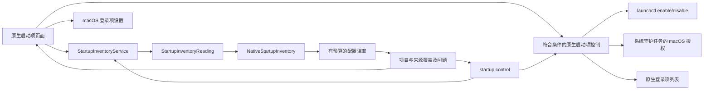
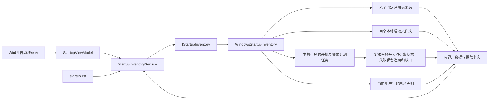
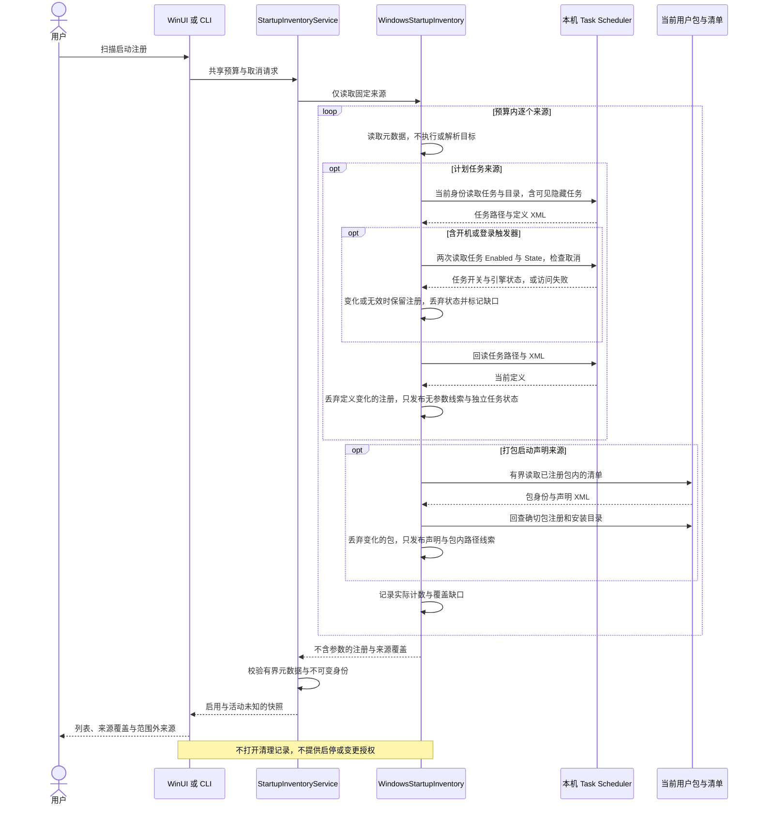

# 启动项管理

[English](../../product/startup-items.md) | 简体中文

macOS 原生页面按已确认的应用路径聚合启动项，提供总数与启用计数、全部／已启用／已禁用／残留项筛选、搜索、行内开关和展开详情。直接控制覆盖符合条件的 LaunchAgent、第三方系统守护任务和原生应用登录项；其余注册保留 macOS 设置入口。Windows 来源、控制范围与验证边界见下文。

## 用户流程

打开“启动项”读取 launchd 定义和可用的登录注册。可按应用、发布者、标签、配置路径或执行路径搜索。展开应用后查看每项注册的来源、配置状态、运行状态和触发线索，复制路径或在访达定位。Apple 系统定义通过“启动项选项”主动纳入。“重新扫描”读取新事实，“停止”请求协作取消；刷新时保留已有列表。

启用、禁用和移除均先展示确切受影响配置并要求确认。启停更改当前用户 GUI 域的 launchd 覆盖设置；移除仅把符合条件的当前用户普通配置通过既有文件系统适配移到废纸篓。不会终止已运行进程。平台重新核验来源、父目录、所有者、文件身份、内容及标签，并回读覆盖设置或验证废纸篓结果。整组操作存在部分失败时也重新扫描。

`/Library/LaunchDaemons` 直属、由 root 拥有且符合安全条件的第三方配置，通过固定的 `launchctl enable/disable system/<label>` 操作请求 macOS 管理员授权；Apple 配置继续受保护。原生登录项只增删当前账户登录列表中确切的本地第三方应用，执行前核验完整快照与身份，执行后重新读取验证。BTM 应用记录优先采用原生列表判断启用状态；仅有 BTM 回退事实时保留只读。

仅在本地文件系统能确认执行目标不存在时标为残留。无权限、无法解析的执行路径、链接和离线卷保留未知状态。同名不代表同一应用；部分启用单独呈现，未知状态不会当作禁用。系统设置入口使用公开的 `SMAppService.openSystemSettingsLoginItems()` API。

## 覆盖与隐私

| 来源 | 默认行为 | 事实范围 |
| --- | --- | --- |
| `~/Library/LaunchAgents` | 包含 | 当前用户配置 |
| `/Library/LaunchAgents` | 包含 | 所有用户代理配置 |
| `/Library/LaunchDaemons` | 包含 | 所有用户守护配置 |
| `/System/Library/LaunchAgents`、`/System/Library/LaunchDaemons` | 可选 | Apple 系统配置 |
| 活跃登录项 | 原生共享列表可用时包含 | 完整原生快照；符合条件的确切应用支持启停 |
| 后台应用记录 | BTM v13 可读时包含 | 有界、纯数据 plist 解析；版本及权限缺口明确列出 |
| 应用内辅助程序 | 本次扫描范围之外 | 在系统设置中查看 |

`complete` 仅表示本次请求的配置来源已检查，不代表已枚举 macOS 全部启动注册项目。来源不存在、权限缺口、无效配置和预算限制分别记录；读取失败不能解释为没有启动项。

读取使用目录描述符，拒绝祖先与末级链接、拒绝特殊文件，并在读取后比较文件元数据。单份配置上限为 256 KiB，默认最多遍历 2,000 项、五秒，在操作之间检查取消与单调时钟截止时间；无法中断内核中不可中断的文件系统调用。不保留或输出参数与环境变量值；可执行文件仅取绝对且可显示的 Program 字段或 ProgramArguments 首项。状态查询仅返回固定状态；成功查询且无覆盖时采用 Disabled 配置默认值，查询失败则保留未知。BTM 读取拒绝未知版本，不实例化归档类。发现阶段不会执行改变状态的命令。

## 职责与流程



Core 负责可移植结果、纯应用聚合／筛选和启停合同；平台适配负责来源路径、定义解析、物理读取、原生注册和授权边界；桌面负责搜索、原生呈现、确认和系统设置导航。发现与启停过程不打开清理记录存储，不能产生清理计划。

## Windows 启动项合同

状态：只读 C# Core、Platform、CLI 与 WinUI 源码已实现，包含 Task Scheduler 开机／登录任务与当前用户打包应用启动声明，原生验收待完成。符合条件的当前用户计划任务启停已有独立源码，公共门禁关闭；其他来源控制与原生验收仍待完成。

### 来源与事实

| 来源 | 范围与观察 |
| --- | --- |
| HKCU `Software\Microsoft\Windows\CurrentVersion\Run` 与 `RunOnce` | 当前用户；共享键，通过 64 位注册表视图读取 |
| HKLM 相同路径的 64 位与 32 位视图 | 四个系统级来源，各视图分别保留 |
| `Environment.SpecialFolder.Startup` | 当前用户启动文件夹，包含受支持的本地重定向 |
| `Environment.SpecialFolder.CommonStartup` | 共享启动文件夹 |
| 本机 Task Scheduler | 当前身份可见、含 `BootTrigger` 或 `LogonTrigger` 的任务，包括可见的隐藏任务；不筛选或推断触发器所属用户 |
| 当前用户已注册包的清单 | `desktop`／`uap5` 的 `windows.startupTask` 声明；排除框架、资源包和 bundle，不推断是否已激活注册 |
| 其他计划任务、其他用户私有来源、打包任务的实际激活／启用状态 | 不在本次范围，明确列出限制，不能解释为没有注册 |

`StartupInventoryService` 校验十个受支持来源的一次不可变观察。`StartupItem` 保留绑定来源的注册 ID、名称、可选绝对可执行／配置路径及结构化问题。注册表值名称和计划任务标识的身份忽略大小写，文件夹注册保留实际路径；打包声明使用确切包版本、应用 ID 和区分大小写的 TaskId 摘要。计划任务路径是调度器标识，不能转换为文件访问权限。同名不能证明应用归属，也不合并注册。有效启用状态保持 `unknown`，进程活动为 `not_observed`，残留状态为 null，`control_available=false`。存在注册、清单声明或可执行路径线索不代表 Windows 会运行该项目。

读取不展开环境变量、不执行注册命令。单个注册表值最多读取 8 KiB UTF-16 数据，发布前再次读取核对；仅提取无歧义的绝对 `.exe`／`.com` 路径，参数在进入 Core 前丢弃。带引号的路径允许空格；无引号且有歧义的路径、相对名称、网络路径与环境引用保持未解析。宿主可执行文件不能标识其参数中指定的应用。

文件夹读取只检查受支持本地 NTFS／ReFS 的直属条目，拒绝 reparse／不支持对象及其祖先，枚举前后核对源目录。跳过目录与 `desktop.ini`，其余普通文件保留注册元数据；不打开或解析 `.lnk` 及其他关联文件。只有直接的 `.exe`／`.com` 文件暴露自身可执行路径。不推断目标存在、进程状态或发布者。

计划任务通过本机 Task Scheduler 2.0 Automation、当前身份连接并逐目录读取。每次打开目录、读取子目录条目和检查任务均消耗共享条目预算，非启动任务也计数；最多深入 32 层。COM 代理只由本次原生 worker 使用和释放，不运行任务、不注册或修改任务。任务路径和 XML 在发布前回读核对；目录集合数量变化、无权限、无效定义、深度或条目限制都产生覆盖缺口。该观察不是系统级原子快照，同数量替换和最终回读后的变化仍可能存在。

单份 XML 在 COM 返回后限制为 256 Ki 字符；COM 字符串分配发生在此检查之前。解析禁止 DTD、外部实体与自定义类实例化，只接受标准任务命名空间。仅当恰好一个 `Exec` 动作和一个 `Command` 时提供字面、本地、绝对 `.exe`／`.com` 线索；多动作、COM Handler、环境变量或其他目标保持未知。参数、描述、工作目录、用户标识及原始 XML 不进入 Core 或输出。任务的 Enabled、触发器和账户条件不会被推导为有效启用或活动状态。

对于已识别的开机／登录任务，Platform 读取公开的 `RegisteredTask.Enabled` 和 `RegisteredTask.State`。连续两次读取一致，且随后路径与 XML 复核仍一致时，条目的 `scheduled_task` 保存布尔 `enabled` 与 `state=unknown|disabled|queued|ready|running`；其他来源和未成功观察的任务为 null。Core 拒绝其他来源伪报此字段及范围外状态值。`enabled` 表示任务自身的开关，`state` 表示任务引擎报告的实例状态，均不表示启动触发器、账户、网络或电源条件已满足，也不判断应用进程是否仍运行。

状态变化、权限／COM 读取失败或无效值会丢弃状态、保留经过定义复核的注册，并在条目和来源分别报告 `scheduled_task_status_changed`、`scheduled_task_status_unavailable` 或 `scheduled_task_status_invalid`；来源标为 partial。定义或路径变化则丢弃整个注册。每次系统属性读取之间检查取消；非启动任务不读取状态。此复核不能消除两次相同值之间的变化或最后一次回读后的竞态。界面详情按“任务计划程序报告”展示状态，提醒与实际启动／应用活动的区别；刷新不会把旧状态填入新观察中的未知字段。

打包声明通过 `PackageManager.FindPackagesForUser` 的当前用户结果定位 `AppxManifest.xml`。读取使用固定的包内文件名、有大小上限的句柄读取、不跟随祖先或末级 reparse point，并比较读取前后的文件元数据；不申请额外权限。只读清单可以是硬链接普通文件，规则文件仍要求单链接。每份清单最多 4 MiB，禁止 DTD 与外部实体；只解析 Windows 10 foundation 下应用级的 `desktop`／`uap5` 启动扩展，其他启动扩展命名空间显示覆盖缺口。发布前重新查询确切包注册与安装目录，变化时丢弃该包候选。

包、应用、扩展及启动声明分别计入共享条目预算；框架／资源／bundle 及拒绝项也消耗实际检查预算。耗尽后不打开下一份清单。包枚举可能预读一个元数据对象，单份 XML 的解析工作受字节上限约束；该观察仍不是系统级原子快照。可执行线索优先取扩展的 `Executable`，否则取应用值，只接受包目录内的相对 `.exe`／`.com` 路径，不展开变量、资源引用或参数，不检查执行目标是否存在。`ms-resource:` 显示名使用 TaskId 回退，超长 ID 使用应用 ID；TaskId 最长 32,767 字符，身份摘要保持有界。原始 XML、参数和能力声明不进入 Core 或输出。

清单的 `Enabled`／`ImmediateRegistration` 仅是声明，不表示当前用户已经激活或允许该任务。公开的 `StartupTask.GetForCurrentPackageAsync` 只面向调用者自身包；Shou 不冒用它查询其他包、不读取私有启用数据库。打包来源因此报告声明发现和未知状态，不能作为启停授权。

### 预算与入口

共享默认预算为 2,000 条检查与五秒，最大 10,000 条与 60 秒。计数包含拒绝和忽略的条目，不存在、部分、不可用及未检查来源分别表达。超时 worker 保留调度槽，原生 worker 最多同时运行两个；取消不能强制阻塞的内核或 COM 读取返回。来源失败后已消费的条目数未知时，不再把该部分预算用于后续来源，标为 `entry_budget_unknown`；之前完成的来源仍保留。目录读取使用有界预取，因此进行中的元数据读取可能多于已发布的检查计数。

`complete` 仅适用于列出的十个来源、本次可见任务和包清单声明，不表示全系统任务、打包任务的实际激活或一致时刻的完整观察。每份结果均说明范围外来源及未知的启用／活动状态。发现不打开清理存储，也不创建计划。

```sh
shou startup list --json
shou startup list --source current-user-run --search Example --limit 50 --json
shou startup list --source scheduled-tasks --limit 50 --json
shou startup list --source packaged-startup-tasks --limit 50 --json
```

可选输入为 `--source`、`--search`、`--offset`、`--limit`、`--max-entries` 与 `--max-seconds`。来源值为 `current-user-run`、`current-user-run-once`、`machine-run64`、`machine-run32`、`machine-run-once64`、`machine-run-once32`、`current-user-startup`、`common-startup`、`scheduled-tasks`、`packaged-startup-tasks`。来源筛选作用于已观察快照，不扩大预算或跳过前置来源。搜索不超过 256 个可显示字符，分页为 1–500 项。CLI 每次重新观察，跨调用的偏移分页不是稳定 cursor。部分覆盖返回退出码 6，外部取消返回 130；拒绝启用或移除注册的参数。

Windows 页面在同一内存快照内搜索、按来源筛选及分页。刷新时保留旧列表并标明来自上次扫描，直到新结果到达；取消、失败和被新请求替代的结果不能作为新观察发布。原生布局、可访问性和取消仍需要 Windows 证据。





其他来源的后续控制必须绑定精确注册和当前配置，操作前重新核验并确认，使用已验证的公开系统接口，不猜测私有启用格式。只读链路不提供控制授权。参考 [Microsoft Run／RunOnce 合同](https://learn.microsoft.com/en-us/windows/win32/setupapi/run-and-runonce-registry-keys)、[Task Scheduler](https://learn.microsoft.com/en-us/windows/win32/taskschd/task-scheduler-start-page) 和 [GetTasks 隐藏任务标记](https://learn.microsoft.com/en-us/windows/win32/taskschd/taskfolder-gettasks)。

打包来源参考 [desktop:StartupTask](https://learn.microsoft.com/en-us/uwp/schemas/appxpackage/uapmanifestschema/element-desktop-startuptask)、[uap5:StartupTask](https://learn.microsoft.com/en-us/uwp/schemas/appxpackage/uapmanifestschema/element-uap5-startuptask) 和 [当前包 StartupTask API](https://learn.microsoft.com/en-us/uwp/api/windows.applicationmodel.startuptask.getforcurrentpackageasync)。

计划任务状态参考 [RegisteredTask.Enabled](https://learn.microsoft.com/en-us/windows/win32/taskschd/registeredtask-enabled)、[RegisteredTask.State](https://learn.microsoft.com/en-us/windows/win32/taskschd/registeredtask-state) 和 [TASK_STATE](https://learn.microsoft.com/en-us/windows/win32/api/taskschd/ne-taskschd-task_state)。这些 API 的文档与 Mac 上逻辑测试不能替代真实 Windows COM、权限和 UI 验收。

### 计划任务开关审阅与控制

状态：Core、Platform、Presentation、CLI 与 WinUI 源码已实现；`WindowsStartupControlMutation.PublicExecutionAvailable=false`，GUI 与 CLI 共用该门禁，当前仅开放只读审阅，未开放任务变更。

审阅指定的确切开机／登录任务，要求安全描述符所有者与 XML `Principal.UserId` 都匹配当前用户字面 SID，声明 `InteractiveToken` 和明确的 `RunLevel=LeastPrivilege`，并拒绝 `\Microsoft` 及其后代、组主体、账号名解析、重复字段和读取缺口。缺失 RunLevel 不作为可控制证据；声明不保证实际运行权限，UAC 等系统条件仍由 Windows 决定。其他用户身份、任务 XML、参数和描述不进入记录，只保存当前执行者 SID、资格布尔值与不透明定义摘要。仅排除任务自身的 `Settings/Enabled` 参与定义摘要，动作或其他设置变化均使审阅失效。

`StartupControlReviewer` 不打开存储，生成有效五分钟的内存审阅。执行必须重新读取同一任务并匹配摘要，由当前入口确认确切任务与动作；确认最长一分钟且不晚于审阅过期。服务取得现有跨进程变更租约，再次复核后先持久化 `applying` 意图，再设置公开的 `RegisteredTask.Enabled`。不运行、停止、注册或删除任务，不请求提权，也不改变注册表、快捷方式或打包任务。禁用不会停止已运行实例；启用不保证触发条件满足。

系统调用后等待真实结果并回读身份、定义与开关。只有 setter 返回且定义／身份一致、开关符合请求时记录 `completed`；无法确认时保留 `unknown`，不自动重试、回滚或恢复。停止在派发前阻止变更；派发后保留租约等待结果。任何已有意图都禁止重放；记录写失败保留操作 ID，缺少记录不能证明任务未变更。查询记录不会恢复执行资格。WinUI 在派发后清空可执行审阅，保留结果查询，变更中限制选择、导航，正常关窗请求停止并等待；强制终止不在该等待保证内。

CLI 参数与退出码见 [Windows 指南](../engineering/windows.md#计划任务开关)，流程及时序见[核心流程](../architecture/workflows-and-sequences.md#windows-计划任务开关)。必须另行验证生成任务的真实 COM、所有者安全描述符、权限、并发替换、中断、终端确认和 WinUI；Mac 模拟检查不构成原生控制验收。

API 参考：[Enabled](https://learn.microsoft.com/en-us/windows/win32/taskschd/registeredtask-enabled)、[GetSecurityDescriptor](https://learn.microsoft.com/en-us/windows/win32/taskschd/registeredtask-getsecuritydescriptor)、[Principal.LogonType](https://learn.microsoft.com/en-us/windows/win32/taskschd/principal-logontype)、[RunLevel](https://learn.microsoft.com/en-us/windows/win32/taskschd/principal-runlevel)。

计划任务控制已有[仅处理生成任务的原生验收入口](../engineering/windows.md#生成计划任务的原生控制验收)。它不接受真实现有任务参数，不运行任务，默认跳过；Windows 实测、并发／中断、权限、终端及界面仍待完成，不能据源码或 Mac 检查宣称支持。
