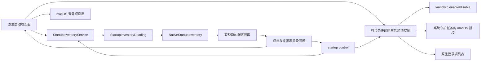

# 启动项管理

[English](../../product/startup-items.md) | 简体中文

macOS 原生页面按已确认的应用路径聚合启动项，提供总数与启用计数、全部／已启用／已禁用／残留项筛选、搜索、行内开关和展开详情。直接控制覆盖符合条件的 LaunchAgent、第三方系统守护任务和原生应用登录项；其余注册保留 macOS 设置入口。Windows 来源、控制范围与验证边界见下文。

## 用户流程

打开“启动项”读取 launchd 定义和可用的登录注册。可按应用、发布者、标签、配置路径或执行路径搜索。展开应用后查看每项注册的来源、配置状态、运行状态和触发线索，复制路径或在访达定位。Apple 系统定义通过“启动项选项”主动纳入。“重新扫描”读取新事实，“停止”请求协作取消；刷新时保留已有列表。

启用、禁用和移除均先展示确切受影响配置并要求确认。启停更改当前用户 GUI 域的 launchd 覆盖设置；移除仅把符合条件的当前用户普通配置通过既有文件系统适配移到废纸篓。不会终止已运行进程。平台重新核验来源、父目录、所有者、文件身份、内容及标签，并回读覆盖设置或验证废纸篓结果。整组操作存在部分失败时也重新扫描。

`/Library/LaunchDaemons` 直属、由 root 拥有且符合安全条件的第三方配置，通过固定的 `launchctl enable/disable system/<label>` 操作请求 macOS 管理员授权；Apple 配置继续受保护。原生登录项只增删当前账户登录列表中确切的本地第三方应用，执行前核验完整快照与身份，执行后重新读取验证。BTM 应用记录优先采用原生列表判断启用状态；仅有 BTM 回退事实时保留只读。

仅在本地文件系统能确认执行目标不存在时标为残留。无权限、无法解析的执行路径、链接和离线卷保留未知状态。同名不代表同一应用；部分启用单独呈现，未知状态不会当作禁用。系统设置入口使用公开的 `SMAppService.openSystemSettingsLoginItems()` API。

## 覆盖与隐私

| 来源 | 默认行为 | 事实范围 |
| --- | --- | --- |
| `~/Library/LaunchAgents` | 包含 | 当前用户配置 |
| `/Library/LaunchAgents` | 包含 | 所有用户代理配置 |
| `/Library/LaunchDaemons` | 包含 | 所有用户守护配置 |
| `/System/Library/LaunchAgents`、`/System/Library/LaunchDaemons` | 可选 | Apple 系统配置 |
| 活跃登录项 | 原生共享列表可用时包含 | 完整原生快照；符合条件的确切应用支持启停 |
| 后台应用记录 | BTM v13 可读时包含 | 有界、纯数据 plist 解析；版本及权限缺口明确列出 |
| 应用内辅助程序 | 本次扫描范围之外 | 在系统设置中查看 |

`complete` 仅表示本次请求的配置来源已检查，不代表已枚举 macOS 全部启动注册项目。来源不存在、权限缺口、无效配置和预算限制分别记录；读取失败不能解释为没有启动项。

读取使用目录描述符，拒绝祖先与末级链接、拒绝特殊文件，并在读取后比较文件元数据。单份配置上限为 256 KiB，默认最多遍历 2,000 项、五秒，在操作之间检查取消与单调时钟截止时间；无法中断内核中不可中断的文件系统调用。不保留或输出参数与环境变量值；可执行文件仅取绝对且可显示的 Program 字段或 ProgramArguments 首项。状态查询仅返回固定状态；成功查询且无覆盖时采用 Disabled 配置默认值，查询失败则保留未知。BTM 读取拒绝未知版本，不实例化归档类。发现阶段不会执行改变状态的命令。

## 职责与流程

Core 负责可移植结果、纯应用聚合／筛选和启停合同；平台适配负责来源路径、定义解析、物理读取、原生注册和授权边界；桌面负责搜索、原生呈现、确认和系统设置导航。发现与启停过程不打开清理记录存储，不能产生清理计划。

## Windows 启动项合同

状态：待实现。Windows 独立 C# 服务负责发现和控制，按[原生方案](../engineering/windows-native-plan.md)实施。

优先明确当前用户 Run、RunOnce、Startup 与 Task Scheduler 的支持范围。系统来源与其他用户来源单独声明；不支持的来源显示原因。注册身份、有效启用状态和进程运行状态分别表达，未知状态不推断为失效残留。

控制能力必须绑定精确注册和当前配置，操作前重新核验并确认。只使用已验证的公开系统接口；不得通过猜测注册表格式改变启用状态。实际来源、控制范围、预算、取消和 UI 交互均需要 Windows 原生证据。
