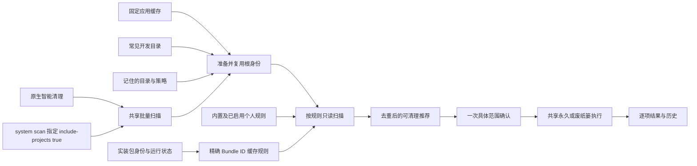
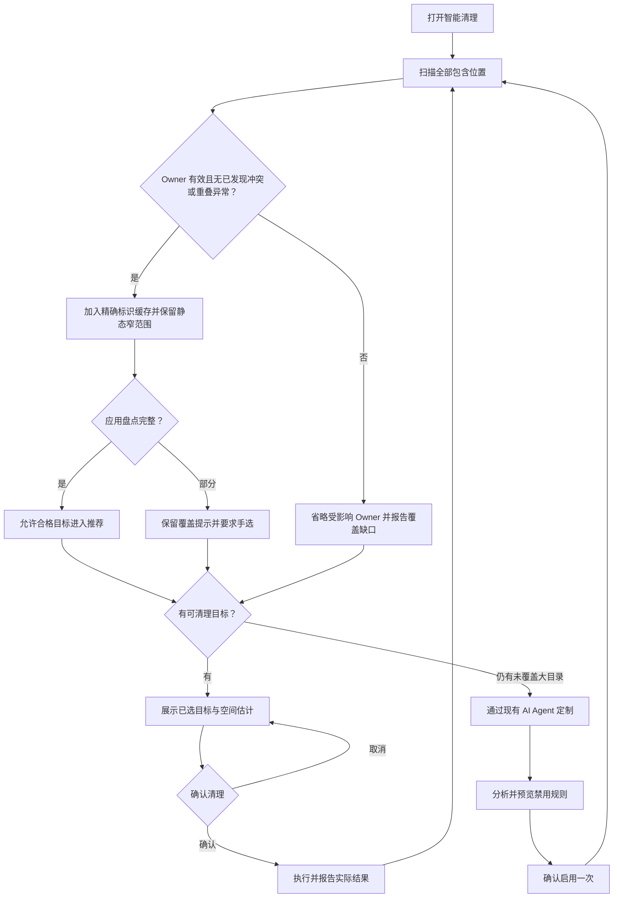
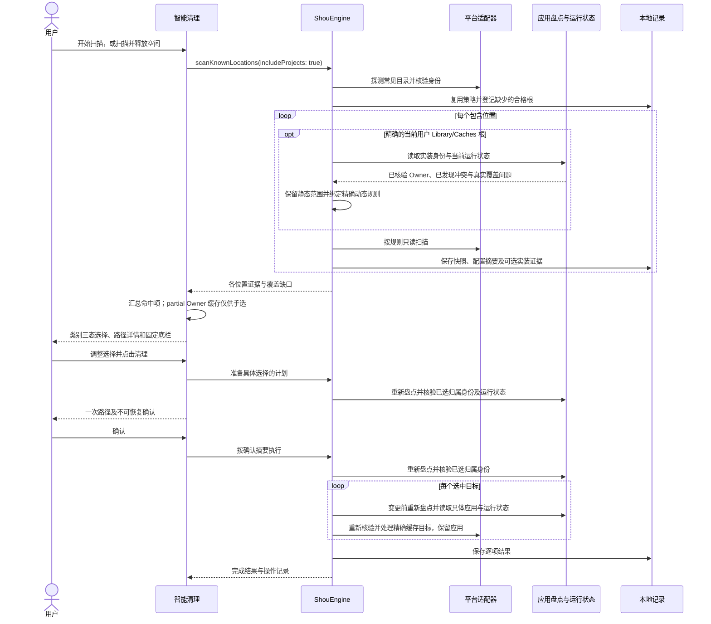

# 统一日常清理

[English](../../product/unified-cleanup.md) | 简体中文

Shou 通过自动发现和统一清理为用户省时间。“项目清理”退出主导航，侧栏不再要求登记工作区。智能清理一次扫描应用缓存、开发工具缓存、项目产物及已启用的个人规则，通过一次具体范围确认完成清理。

## 使用体验

1. 打开智能清理，点击“开始扫描”；旁边菜单保留“扫描并释放空间”和“扫描位置”。
2. 自动发现固定缓存位置、常见开发目录和之前包含的文件夹，应用内置及已启用的个人规则，选中符合条件的结果。
3. 确认一次具体路径。默认永久删除，废纸篓为主动选择的替代方式；逐项展示结果与可恢复能力。

首页集中展示一个扫描主动作、当前磁盘容量与可选的 Agent 定制入口。智能清理和设置中的“扫描位置”为可选查看页；“包含其他文件夹”可以一次选择多个额外目录，并在以后自动扫描。高级规则预览仍可进入单个目录的详情页，并提供返回智能清理的操作。

结果按用户缓存文件、应用缓存、浏览器数据、开发工具、项目构建产物分类；命中个人规则时另行显示。分类与底栏均按规则组计数，展开后展示不同项目下的全部命中目录、文件数、大小、受阻原因及独立勾选。分类和规则组支持三态选择，搜索匹配规则名及完整路径；大组先展示 10 个位置，余下内容分批加载。底部选择方式作用于全部类别，明细标题栏只选择当前显示的结果。高风险产物及依赖必须手动选择，不进入智能推荐。

用户缓存包含内置应用／工具缓存、pnpm、浏览器自动化下载及指定的 macOS 服务缓存。Homebrew、Node.js 工具链和 SwiftPM 分组复用原共享规则绑定。pnpm 存储仅匹配 `~/Library/pnpm/store`，保留全局可执行程序与配置。未知目录不会仅因位于缓存根下就获得清理权限。

大文件清理跨目录汇总符合条件的文件；空间分析负责目录浏览与矩形树图，两者均可直接选择内容清理。启动项、应用管理、清理规则与操作记录保留各自独立用途。

## 自动发现

`ProjectLocations` 只探测当前用户主目录下的一组常见项目集合：`Developer`、`Projects`、`Code`、`code`、`dev`、`src`、`repos`、`GitHub`，以及 `Documents` 下的 `Developer`、`Projects`、`Code`、`dev`、`GitHub`。这是目录元数据发现，不递归枚举整个主目录；Windows 发现等待经验证的平台适配器。

新增发现提示包括 Workspace／Workspaces、Development、Source／Sources、Git／Repos、Documents 下对应的常见集合，以及 Desktop 下的 Projects／Code／dev。其他位置和外接磁盘中的项目，包含文件夹一次后即可参与扫描。集合目录内部递归匹配，嵌套仓库无需逐个登记。

随应用提供的项目规则覆盖 Rust target、Node 依赖与框架缓存、Node build／dist、Swift debug／release 产物、Python 字节码／测试／类型分析缓存、Gradle build／缓存、Maven target、Flutter build／.dart_tool 和 CMake 构建目录。通用 build／cache 名称必须有精确的本地项目清单；所有可信项目规则均核验 Git 跟踪内容和项目构建活动，纯二进制产物也不例外。生成源码例外要求对应工具的可核验产物布局；手写源码、项目清单、凭据及 Git 跟踪内容继续受保护。不支持的布局保留明确受阻原因，不凭目录名获得删除权限。

只为存在、本地且根身份有效的目录准备扫描。不存在的位置跳过；不可访问目录和符号链接明确报告覆盖问题；同一身份的别名去重。目录名称仅用于发现位置，不能作为删除证据：命中目标仍需规则、项目标记、活动检查、排除项和完整目标清单。

批量扫描同时遵守平台读取容量：原生隔离读取进程最多并行扫描两个根，直接读取保留最多四个根的请求上限。每个已准备的根都返回结果或明确问题，避免调度容量冲突造成缓存和项目集合漏扫。

单个根内先发现目录，再测量候选内容。每个待测目录按剩余数量分配文件数和时间预算，因此前面的巨大产物目录超限时，后面的项目仍有机会得到独立完整的结果。原根的规则绑定和排除项继续生效；未完成的目录可见但不可勾选，发现目录本身不构成清理资格。

未完成目录在明细和右键菜单中提供“继续扫描此目录”。此只读操作使用独立的有限预算测量精确目标，继续遵守原根、已启用规则、排除项和安全检查；进度显示具体目录并支持停止。成功后仅替换该目录的显示证据，保留其他结果与选择，更新目录需要重新勾选。取消或失败保留原结果；配置或身份变化要求重新扫描。单目录完成不会把父项目集合标成完整，仍超限的目标继续阻止清理。

已有位置复用原逻辑引用、规则绑定及排除项。自动建议与已登记根重叠时跳过建议，避免引入范围更大的重叠根绕过既有策略。因此，显式登记的子项目可能限制其父集合目录的自动发现；需要时可包含其他不重叠的项目集合。

全部根准备完成后才捕获首个快照，确保同批快照配置摘要一致。`Workspace` 保留为内部身份与规则范围记录，并兼容现有 CLI；用户无需把它作为独立功能管理，也不必先进入登记页面。

### 已安装应用缓存

macOS 在精确的 `~/Library/Caches` 根扫描中，额外通过平台目录读取已安装应用。有效实装 Owner 和已发现范围内无重复的合法 Bundle ID 生成只匹配该标识的相对规则；应用名称清单及标识提示不构成执行授权。既有静态缓存模式优先，包括已禁用规则和仅覆盖后代的窄规则，通用发现不能扩大这些范围；动态规则也可通过绑定关闭。

只有独立完整、归当前用户且通过共享排除项、受保护内容与禁止跟随检查的缓存清单，才能进入推荐。系统／Apple 应用和当前应用受保护，运行中或状态未知时阻止清理。安装包可以由管理员拥有，因为这里只读核验安装包。缓存清理使用普通计划和回执，不卸载应用，也不选择偏好、支持数据或容器。

不完整应用盘点明确保留覆盖缺口。已检查来源中的有效 Owner 若仅遇到无关路径失败，仍可提供可手选的缓存，并提示可能存在未发现的其他副本；这些候选不进入自动推荐。Owner 自身、后代或祖先路径异常、来源不可用／未检查及已发现的重复标识会阻断该 Owner。盘点整体不可用时省略通用发现；静态规则继续扫描。`ScanSnapshot.status` 仍描述文件系统扫描是否完成；系统汇总遇到上述发现问题时为部分完成。即使已知目录完整，也不表示覆盖任意自定义安装位置或其他账户。

可选的覆盖不完整标记与 Owner 证据一同保存并绑定计划摘要。完整扫描遇到新出现的 partial 盘点时，必须重新扫描并明确审阅。创建计划、执行预检及每项变更前均重新盘点、读取精确安装包与运行状态；新发现的归属冲突或重叠路径异常会阻止清理。

## 个人规则

现有 Agent 分析尚未覆盖的大目录，询问不明确的用途和重建方式，编写规则并预览禁用草稿。用户确认启用一次后，符合条件的命中项自动参与后续智能清理推荐；禁用草稿、预览快照、不完整及受阻目标继续排除。每次真实清理仍确认当前具体范围。

个人规则的启用及预览直接解析规则自身的根引用，不依赖用户另选扫描位置。当前发布版本通过外部 Agent／Skill／CLI 定制；下一阶段内置清理专用 Agent 复用同一规则、预览、启用与确认执行合同，普通日常清理无需联网或重新推理。

## 架构

## 流程

## 时序

## CLI 与验证

`shou system scan --include-projects true --json` 复用相同发现逻辑。CLI 为兼容保留默认 `false`；显式 `scan --workspace` 及 `workspaces` 命令继续服务 Agent 的范围绑定和高级自动化。

验证须覆盖新配置、发现不登记、重复扫描保留策略及摘要、显式重叠范围、符号链接、登记前取消、禁用草稿、启用个人规则自动推荐、隔离夹具实际清理／恢复和安装版原生界面。实际结果记入[验收记录](../engineering/acceptance-and-testing.md)。
