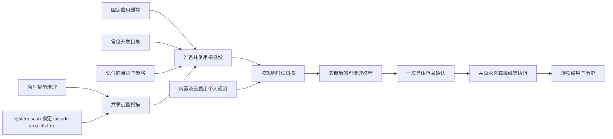
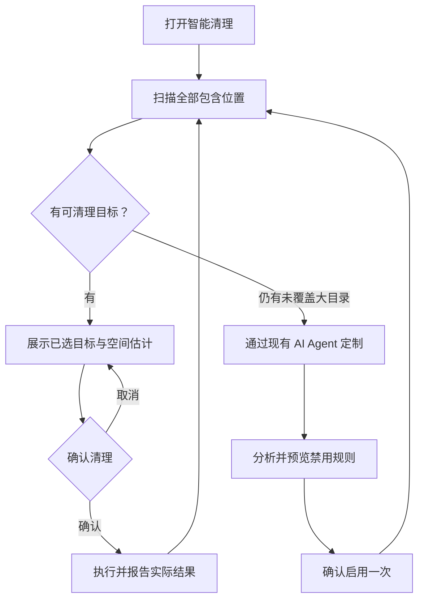
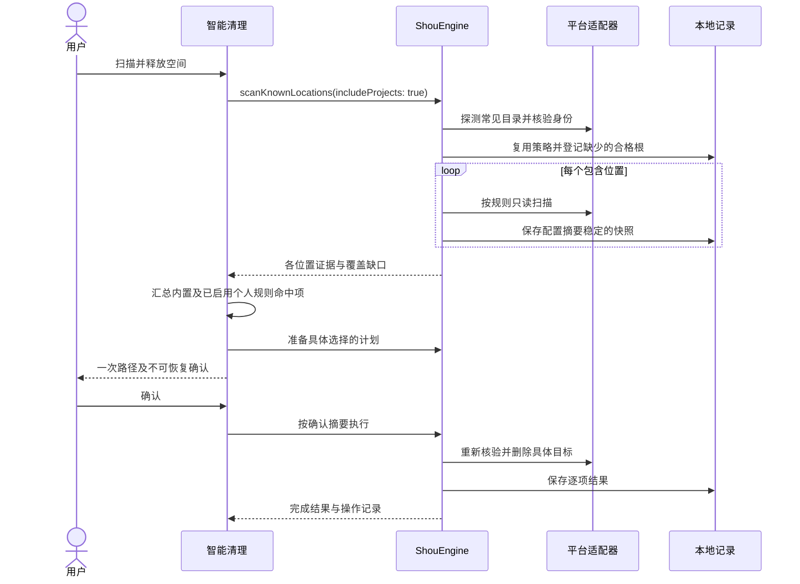

# 统一日常清理

[English](../../product/unified-cleanup.md) | 简体中文

Shou 通过自动发现和统一清理为用户省时间。“项目清理”退出主导航，侧栏不再要求登记工作区。智能清理一次扫描应用缓存、开发工具缓存、项目产物及已启用的个人规则，通过一次具体范围确认完成清理。

## 使用体验

1. 打开智能清理，点击“扫描并释放空间”；想先查看时使用“仅扫描”。
2. 自动发现固定缓存位置、常见开发目录和之前包含的文件夹，应用内置及已启用的个人规则，选中符合条件的结果。
3. 确认一次具体路径。默认永久删除，废纸篓为主动选择的替代方式；逐项展示结果与可恢复能力。

首页汇总已发现位置和启用规则，不要求逐个选择目录。智能清理和设置中的“扫描位置”为可选查看页；“包含其他文件夹”可以一次选择多个额外目录，并在以后自动扫描。高级规则预览仍可进入单个目录的详情页，并提供返回智能清理的操作。

空间分析继续负责查找占用大头、直接选择文件删除。启动项、应用管理、清理规则与操作记录保留各自独立用途。

## 自动发现

`ProjectLocations` 只探测当前用户主目录下的一组常见项目集合：`Developer`、`Projects`、`Code`、`code`、`dev`、`src`、`repos`、`GitHub`，以及 `Documents` 下的 `Developer`、`Projects`、`Code`、`dev`、`GitHub`。这是目录元数据发现，不递归枚举整个主目录；Windows 发现等待经验证的平台适配器。

只为存在、本地且根身份有效的目录准备扫描。不存在的位置跳过；不可访问目录和符号链接明确报告覆盖问题；同一身份的别名去重。目录名称仅用于发现位置，不能作为删除证据：命中目标仍需规则、项目标记、活动检查、排除项和完整目标清单。

已有位置复用原逻辑引用、规则绑定及排除项。自动建议与已登记根重叠时跳过建议，避免引入范围更大的重叠根绕过既有策略。因此，显式登记的子项目可能限制其父集合目录的自动发现；需要时可包含其他不重叠的项目集合。

全部根准备完成后才捕获首个快照，确保同批快照配置摘要一致。`Workspace` 保留为内部身份与规则范围记录，并兼容现有 CLI；用户无需把它作为独立功能管理，也不必先进入登记页面。

## 个人规则

现有 Agent 分析尚未覆盖的大目录，询问不明确的用途和重建方式，编写规则并预览禁用草稿。用户确认启用一次后，符合条件的命中项自动参与后续智能清理推荐；禁用草稿、预览快照、不完整及受阻目标继续排除。每次真实清理仍确认当前具体范围。

个人规则的启用及预览直接解析规则自身的根引用，不依赖用户另选扫描位置。Shou 仅提供 Skill 和 CLI，不接模型、不托管 Agent。

## 架构

## 流程

## 时序

## CLI 与验证

`shou system scan --include-projects true --json` 复用相同发现逻辑。CLI 为兼容保留默认 `false`；显式 `scan --workspace` 及 `workspaces` 命令继续服务 Agent 的范围绑定和高级自动化。

验证须覆盖新配置、发现不登记、重复扫描保留策略及摘要、显式重叠范围、符号链接、登记前取消、禁用草稿、启用个人规则自动推荐、隔离夹具实际清理／恢复和安装版原生界面。实际结果记入[验收记录](../engineering/acceptance-and-testing.md)。
